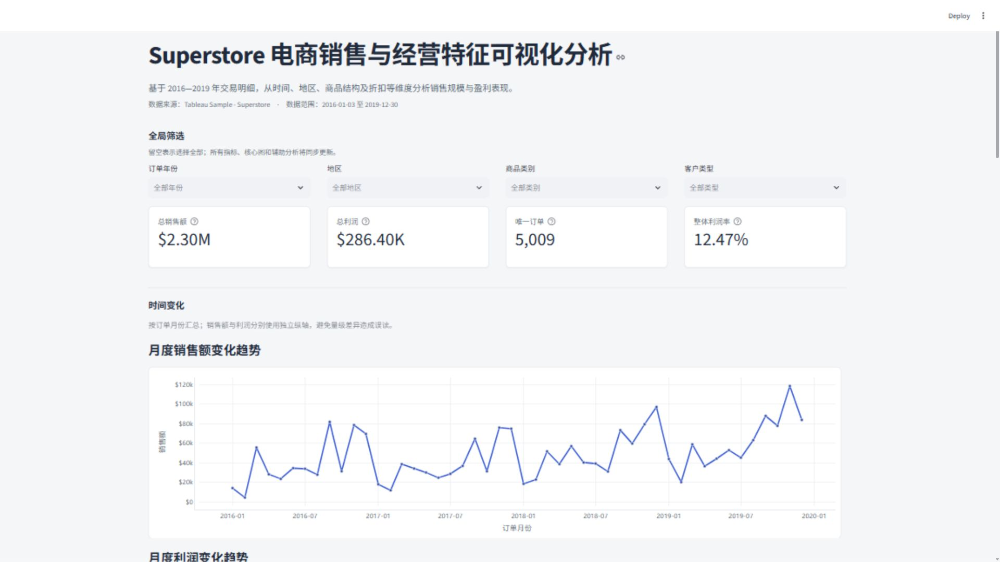
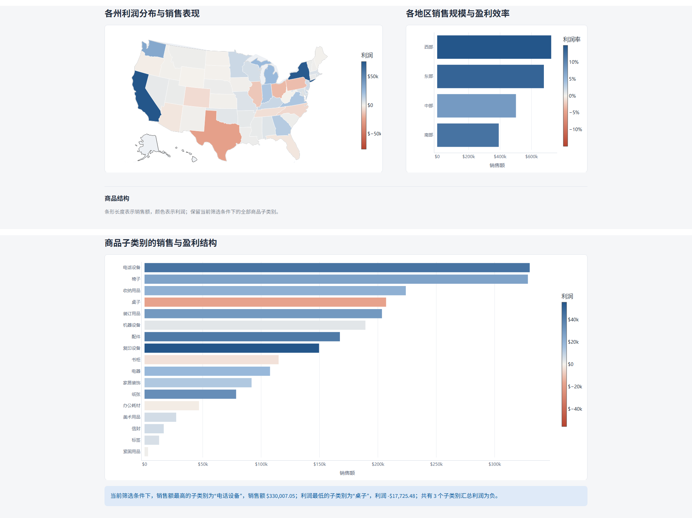
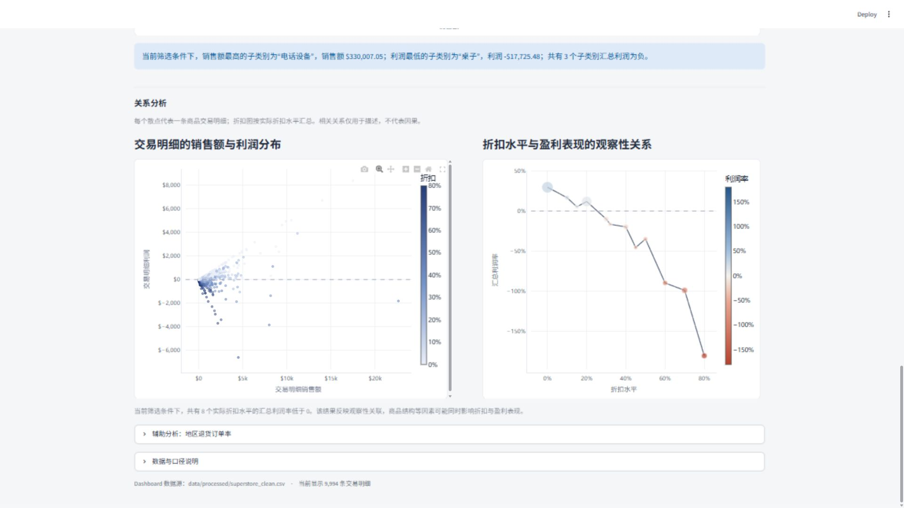

# Superstore 销售与利润分析

一个完整的端到端数据可视化作品集项目：从数据质量检查、清洗和验证，到探索性分析，再到基于 Plotly + Streamlit 的可交互 Dashboard。

[项目报告（DOCX）](docs/superstore-project-report.docx) · [技术演示稿（PDF）](docs/superstore-portfolio-deck.pdf) · [完整演示视频](docs/superstore-demo.mp4)




## 项目概览

本项目使用 Tableau 官方 `Sample - Superstore` 数据集，分析 2016-2019 年的商品交易明细，回答一个核心问题：

> 销售规模的增长是否真正带来了利润增长？不同时间、地区、商品结构和折扣水平下的经营表现有何差异？

项目没有只停留在画图层面，而是先统一交易明细、订单、客户和商品的统计口径，再通过数据验证保证 Dashboard 中的指标与原始数据一致。

## 作品集材料

- [项目报告（DOCX）](docs/superstore-project-report.docx)：完整的数据检查、预处理、分析、Dashboard 实现与总结。
- [技术演示稿（PDF）](docs/superstore-portfolio-deck.pdf)：适合快速浏览的项目概览、核心发现和运行截图。
- [完整演示视频](docs/superstore-demo.mp4)：展示项目背景和 Dashboard 操作流程。

## 项目亮点

- **完整的数据分析流程**：数据检查、字段规范、辅助表连接、探索性分析、可视化设计、交互式应用。
- **可复现的数据口径**：区分 9,994 条交易明细与 5,009 个唯一订单，订单数按 `Order ID` 去重。
- **严格的数据验证**：对行数、订单数、客户数、商品数、销量、销售额、利润和日期范围设置基线校验。
- **业务导向的 Dashboard**：4 个全局筛选器、4 个动态 KPI、8 张交互式图表和当前筛选结果 CSV 下载。
- **关注数据质量风险**：识别退货表重复键导致的记录膨胀风险，并采用去重后的订单集合生成退货标记。

## 核心指标

| 指标 | 全量数据结果 |
|---|---:|
| 商品交易明细 | 9,994 条 |
| 唯一订单 | 5,009 个 |
| 唯一客户 | 793 个 |
| 唯一商品 | 1,862 个 |
| 销售额 | $2,297,200.86 |
| 利润 | $286,397.02 |
| 整体利润率 | 12.47% |
| 分析时间范围 | 2016-01-03 至 2019-12-30 |

## 主要发现

- 销售额与利润并非始终同步变化，单看销售额会掩盖部分月份和商品结构的盈利问题。
- 不同地区、州和商品子类别之间存在明显的销售规模与盈利效率差异。
- 交易明细层面的销售额与利润呈中等程度正相关；折扣与利润呈负向观察性关联，但不应解释为因果关系。
- 部分商品子类别在较高销售额下仍然出现汇总亏损，适合通过利润率而不是销售额单独判断。
- 退货表中 800 条记录只对应 296 个唯一退货订单，说明不能直接用退货行数代替订单数。

## Dashboard 功能

- **全局筛选**：订单年份、地区、商品类别、客户类型。
- **动态 KPI**：总销售额、总利润、唯一订单数、整体利润率。
- **时间分析**：月度销售额趋势、月度利润趋势。
- **空间与地区分析**：美国各州利润地图、地区销售规模与利润率对比。
- **商品结构分析**：商品子类别销售额与利润的联合展示。
- **关系分析**：销售额-利润散点图、折扣水平-利润率关系图。
- **辅助分析**：按唯一订单计算的地区退货订单率。
- **数据导出**：下载当前筛选条件下的交易明细 CSV。





## 技术栈

| 类别 | 技术 |
|---|---|
| 数据处理 | Python, Pandas, NumPy |
| 数据读取 | xlrd |
| 可视化 | Plotly, Matplotlib |
| Web 应用 | Streamlit |
| 工程结构 | 模块化 Python 项目、虚拟环境、可复现依赖 |

## 项目结构

```text
Superstore_Visualization/
├── code/                   # 数据检查、清洗和探索性分析脚本
├── dashboard/              # Streamlit 页面、数据处理与 Plotly 图表模块
├── data/
│   ├── raw/                # 原始 Superstore Excel 文件
│   └── processed/          # 清洗后的分析数据
├── output/
│   ├── figures/            # 分析图表与 Dashboard 截图
│   └── tables/             # 质量检查、统计与分析结果
├── docs/                   # 项目报告、技术演示稿和演示视频
├── report/                 # 完整项目报告
├── .streamlit/             # Streamlit 运行配置
├── run_dashboard.py        # Python 启动入口
├── start_dashboard.bat     # Windows 双击启动入口
└── requirements.txt
```

## 本地运行

环境要求：Python 3.12。

```powershell
python -m venv .venv
.\\.venv\Scripts\python.exe -m pip install -r requirements.txt
.\\.venv\Scripts\python.exe -m streamlit run dashboard/app.py
```

也可以从 IDE 运行 `run_dashboard.py`，或在 Windows 上双击 `start_dashboard.bat`。

浏览器打开：<http://localhost:8501>

## 重新生成分析结果

```powershell
.\\.venv\Scripts\python.exe code/01_data_inspection.py
.\\.venv\Scripts\python.exe code/02_data_cleaning.py
.\\.venv\Scripts\python.exe code/03_exploratory_analysis.py
```

## 数据口径

- 一行代表一条商品交易明细，不代表一个完整订单。
- 订单数按 `Order ID` 去重；客户数按 `Customer ID` 去重；商品数按 `Product ID` 去重。
- 整体利润率统一为 `SUM(Profit) / SUM(Sales)`，不使用交易明细利润率的简单平均。
- Returns 表先提取唯一 `Order ID` 集合，再生成订单级退货标记，避免多对多连接造成行数膨胀。
- 相关分析仅用于描述关系，不代表因果关系。

## 详细报告

完整分析过程、数据检查结果和业务解释见：[项目报告](report/数据可视化大作业报告_终稿.md)。

部署到 GitHub 和 Streamlit Community Cloud 的步骤见：[部署说明](DEPLOYMENT.md)。

## 数据来源与许可

- 数据集：Tableau 官方 `Sample - Superstore` 示例数据集。
- 代码许可：MIT License。
- 数据集版权与使用条款归原始提供方所有，本仓库仅用于学习、分析和作品展示。
