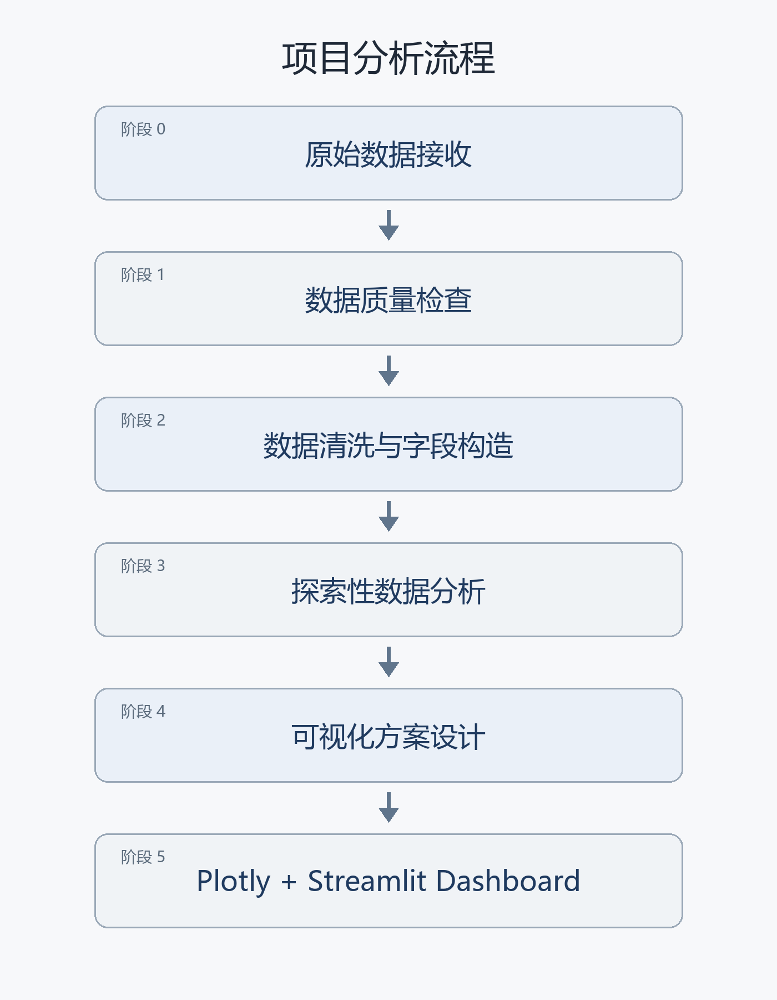
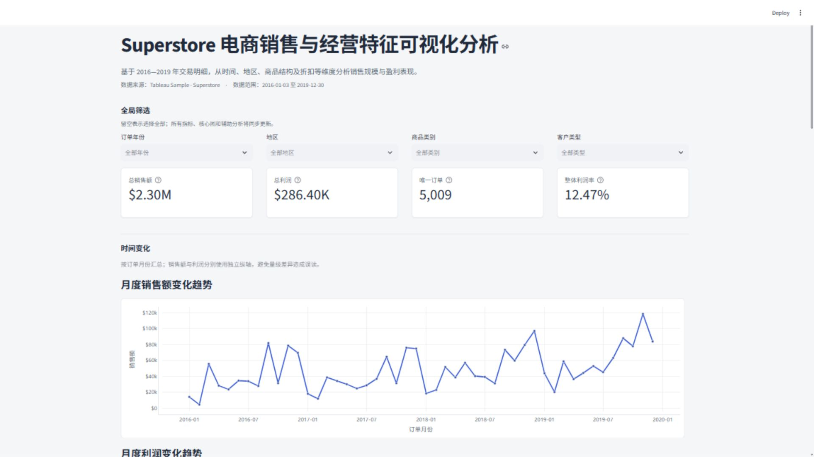
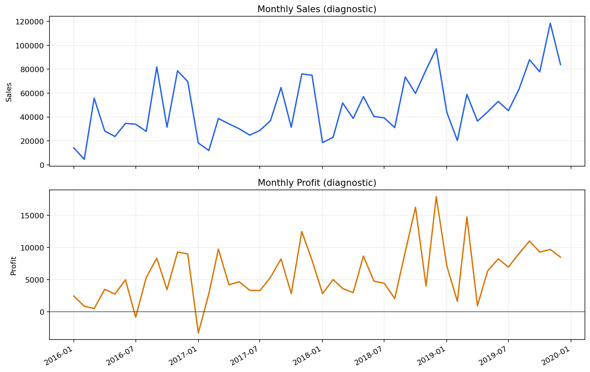
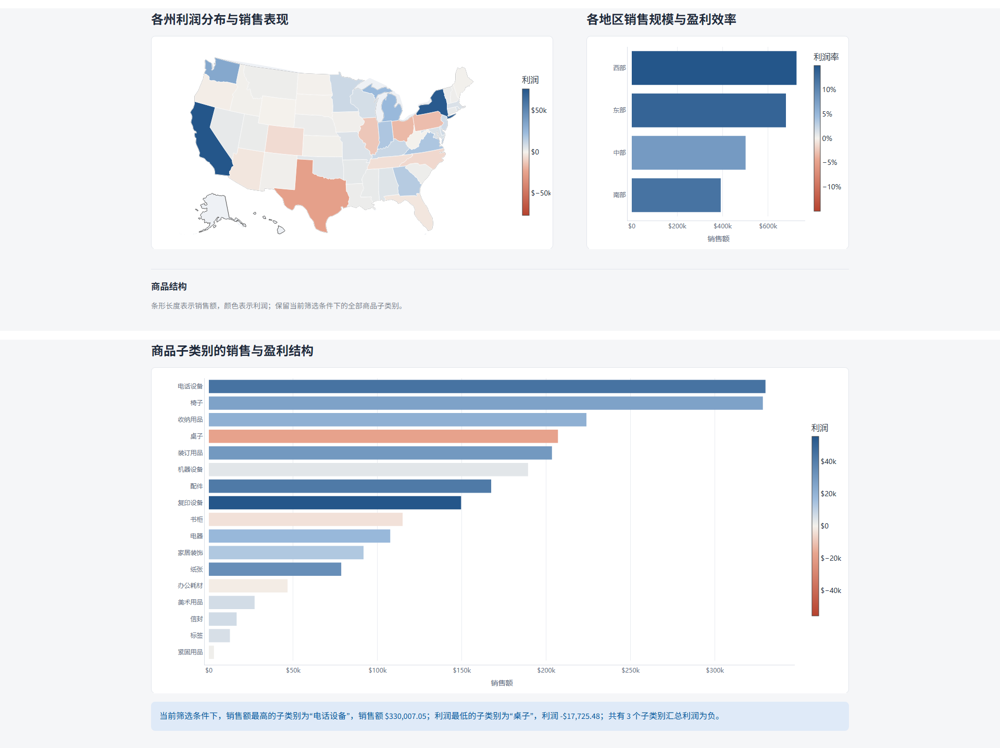
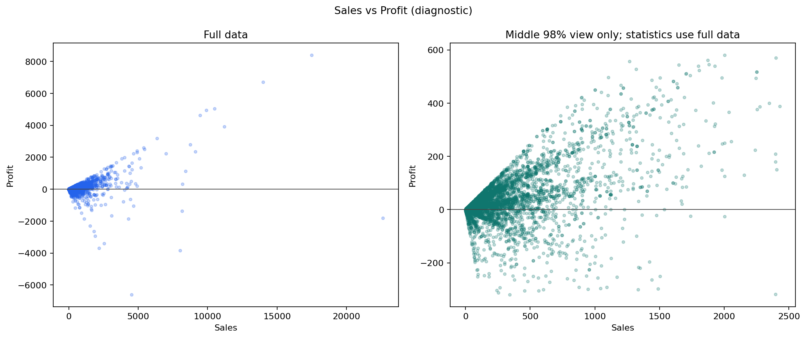
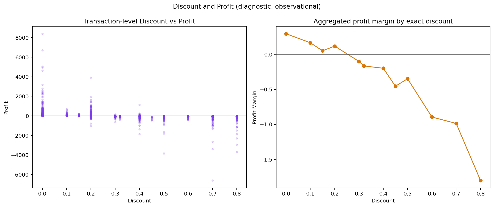
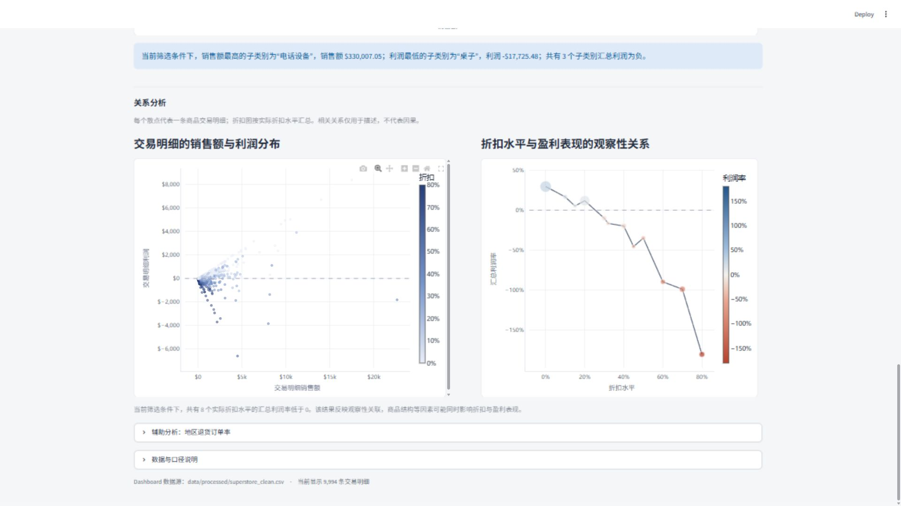

# 电商销售与经营特征可视化分析

## 摘要

本项目以 Tableau 官方 Sample - Superstore 示例数据集为对象，围绕“销售规模与盈利表现是否一致”这一问题，对 2016—2019 年的商品交易明细开展数据质量检查、数据清洗、探索性分析和交互式可视化。项目使用 Python 与 Pandas 完成数据读取、字段规范、统计汇总和结果验证，使用 Plotly 构建图表，并通过 Streamlit 将整体指标、时间趋势、地区差异、商品结构以及销售额、折扣与利润之间的关系组织为单页 Dashboard。分析严格区分交易明细与订单：Orders 表共有 9,994 条商品交易明细，对应 5,009 个唯一订单；整体利润率统一按总利润除以总销售额计算。

全量数据的销售额为 2,297,200.86 美元，利润为 286,397.02 美元，整体利润率为 12.47%。分析发现，销售额与利润的变化方向并非始终一致；不同地区、州和商品子类别之间也存在销售规模与盈利效率不匹配的情况。交易明细层面的销售额与利润呈中等程度正向关联，折扣与利润呈负向观察性关联，但这些相关结果不能解释为因果关系。最终 Dashboard 提供订单年份、地区、商品类别和客户类型四个全局筛选器，使指标与图表能够在统一口径下动态更新。

**关键词：** 电商销售；经营特征；数据可视化；Plotly；Streamlit

# 第一章 项目概述

## 1.1 项目背景

电商销售数据通常同时包含时间、地区、商品、客户、销售额、利润和折扣等多个维度。若只观察销售总额，容易忽略盈利效率上的差异。例如，某一地区或商品可能具有较高销售额，但利润较低甚至为负；一些销售规模较小的商品也可能具有较高利润率。因此，将销售规模与盈利表现结合起来观察，比单独展示销售额更能反映数据中的结构性差异。

本项目不把示例数据包装为真实企业咨询，而是将 Sample - Superstore 作为数据可视化课程实验对象。项目重点在于建立一致的统计口径，识别时间、地区和商品结构中的差异，并把经过验证的统计发现转化为清晰、可交互的可视化表达。

## 1.2 数据来源

数据来自 Tableau 官方 Sample - Superstore 示例数据集，原始文件为 `sample_-_superstore.xls`。工作簿实际包含 Orders、People 和 Returns 三个工作表。Orders 是主要分析表，每一行代表一条商品交易明细；People 提供四个地区与负责人的对应关系；Returns 提供订单级退货辅助信息。

项目的核心分析建立在 Orders 上。People 表的信息量有限，没有为了使用全部工作表而强行加入核心分析；Returns 表用于构造订单级退货状态，并在 Dashboard 中作为折叠的辅助分析区域。原始 Excel 文件接收后保持只读，后续处理结果另存于 `data/processed/`，避免修改原始数据。

## 1.3 项目目标

本项目包括六项具体目标：

1. 分析销售额和利润随时间的变化，比较二者是否同步；
2. 比较不同地区与州的销售规模、利润和利润率；
3. 分析商品类别及商品子类别的销售与盈利差异；
4. 描述交易明细层面销售额与利润的相关特征；
5. 分析实际折扣水平与盈利表现之间的观察性关系；
6. 构建交互式 Dashboard，使用户能够按年份、地区、商品类别和客户类型筛选数据，并查看统一更新的指标与图表。

## 1.4 分析思路

项目依次完成原始数据接收、数据质量检查、数据清洗与字段构造、探索性数据分析、可视化方案设计和 Dashboard 实现。数据检查阶段确认工作簿结构、字段类型、缺失值、重复记录、日期范围和连接风险；清洗阶段在不删除真实业务记录的前提下规范类型并构造分析字段；探索阶段通过时间、地区、商品和相关性分析寻找有数据支持的特征；最后使用 Plotly 和 Streamlit 完成交互式展示。

**图1-1 项目分析流程**

# 第二章 数据获取与预处理

## 2.1 原始数据结构

原始工作簿结构如表2-1所示。

**表2-1 原始工作簿结构**

| 工作表 | 行数 | 列数 | 主要用途 |
|---|---:|---:|---|
| Orders | 9,994 | 21 | 商品交易明细，是核心分析数据 |
| People | 4 | 2 | 地区与负责人对应关系，作为辅助信息 |
| Returns | 800 | 2 | 订单退货辅助信息，用于构造订单级退货状态 |

Orders 的 9,994 行不能直接解释为 9,994 个订单。同一个订单可以购买多个商品，因此可能对应多条商品明细。项目用 Row ID 或行数统计“交易明细数”，用 Order ID 去重数量统计“订单数”。全量数据中共有 5,009 个唯一订单、793 个唯一客户和 1,862 个唯一产品。这一区分贯穿数据清洗、探索性分析和 Dashboard 指标计算，避免把交易明细数量误写成订单数量。

## 2.2 数据质量检查

数据质量检查覆盖字段类型、非空数量、唯一值数量、日期范围、数值分布、重复记录和辅助表连接风险。Orders 的订单日期范围为 2016 年 1 月 3 日至 2019 年 12 月 30 日，发货日期范围为 2016 年 1 月 7 日至 2020 年 1 月 5 日。日期字段均可解析，未发现发货日期早于订单日期的记录。少量订单跨年发货具有合理业务含义，未被当作异常记录。

缺失值集中在 Postal Code 字段，共 11 条，占交易明细的 0.11%，均位于 Burlington, Vermont。对应记录的州、城市和地区信息完整，而邮编不是本项目地图与核心分析的主要字段，因此保留全部记录，不进行人为插补，也不因邮编缺失删除整行。主要数据质量问题及处理结果见表2-2。

**表2-2 数据质量检查与处理结果**

| 问题 | 实际发现 | 处理方式 | 理由 |
|---|---|---|---|
| Postal Code 缺失 | 11 条，均为 Burlington, Vermont | 保留缺失 | 核心地理字段完整，邮编不是核心分析字段 |
| 整行完全重复 | 包含 Row ID 时为 0 条 | 无需处理 | 未发现完全重复行 |
| 疑似重复交易明细 | Row ID 3406、3407 除 Row ID 外一致 | 两条均保留 | 无充分证据判定其中一条错误 |
| 数值极端记录 | Sales、Profit、Quantity、Discount 均存在统计极端值 | 识别并保留 | 极端值可能是真实高额、折扣或亏损交易 |
| Returns 键重复 | 800 行仅有 296 个唯一 Order ID | 去重为订单集合后生成标记 | 避免普通合并造成行数膨胀 |

## 2.3 重复记录检查

以全部字段（包括 Row ID）判断时，Orders 中没有完全重复记录。排除 Row ID 后，发现 Row ID 3406 和 3407 的其他业务字段完全一致。订单数据中出现相同业务字段并不必然意味着错误，且两条记录具有不同 Row ID，现有信息不足以判断其中一条应被删除。因此项目将其记录为“疑似重复交易明细”，但在清洗数据中保留两条记录。

Order ID 的重复属于正常业务现象。数据中有 2,471 个 Order ID 出现在多条交易明细中，相关明细共 7,456 条，单个订单最多包含 14 条明细。项目没有使用 `drop_duplicates()` 无条件去重，也没有把 Order ID 重复当作数据错误。

## 2.4 异常值处理

Sales、Profit、Quantity 和 Discount 的分布中存在统计意义上的极端记录。例如，单条交易明细的最高销售额为 22,638.48 美元，最低利润为 -6,599.98 美元。项目使用描述性统计和 IQR 识别这些记录，但没有把“落在 IQR 范围之外”等同于“数据错误”。高额订单、高折扣交易和亏损交易本身都是后续分析的重要信息，若自动删除会削弱对销售与盈利不匹配现象的观察。

全量数据中有 1,871 条利润为负的交易明细。负利润并非缺失或格式错误，而是盈利分析的必要组成部分，因此全部保留。清洗阶段也没有使用 Z-score、IQR 或箱线图结果自动删除任何记录。

## 2.5 Returns 数据处理

Returns 表有 800 条记录，但只有 296 个唯一退货订单。表中 206 个 Order ID 重复出现，涉及 710 条记录。如果直接按 Order ID 将 Returns 与 Orders 进行普通左连接，Orders 的行数会从 9,994 增长到 12,420，增加 2,426 行，存在明显的记录膨胀风险。

为保持 Orders 的商品交易明细粒度，项目先从 Returns 中提取唯一退货 Order ID 集合，再使用 `isin()` 构造 Returned 字段。处理后 Orders 仍为 9,994 行，其中 Returned = Yes 的交易明细为 800 条，但只对应 296 个唯一退货订单。后续报告与 Dashboard 中的“退货订单数”和“退货订单率”均按唯一 Order ID 统计，不把退货明细行数误称为退货订单数。

## 2.6 分析字段构造

清洗后的主分析数据保留 Orders 原有 21 个字段，并新增 Returned、Order Year、Order Quarter、Order Month 和 Order Year-Month 五个分析字段。Order Year-Month 保存为每月第一天的真实日期，既能在 Python 中正确排序，也便于 Plotly 构建连续月份时间轴。Postal Code 被规范为字符串，非缺失值统一为五位形式，避免 `02108` 一类邮编在数值转换时丢失前导 0；11 条原有缺失仍保持缺失。

项目没有创建“高折扣”“低折扣”或“高销售”等主观分组，也没有把行级利润率的平均值当作整体利润率。所有汇总利润率统一定义为总利润除以总销售额，即 `SUM(Profit) / SUM(Sales)`。

## 2.7 数据清洗结果验证

清洗结果保存为 `data/processed/superstore_clean.csv`。重新读取后，数据为 9,994 行、26 列。清洗前后交易明细数、唯一订单数、唯一客户数、唯一产品数、销售额、利润和订单日期范围均保持一致：销售额仍为 2,297,200.8603 美元，利润仍为 286,397.0217 美元，日期仍为 2016 年 1 月 3 日至 2019 年 12 月 30 日。

这些核验结果表明，本项目的数据清洗以类型规范、风险控制和分析字段构造为主，而不是以大量删除数据为目标。清洗后的变化均可解释，没有因缺失值、重复值或异常值处理造成交易数据损失。

# 第三章 数据分析

## 3.1 整体经营特征

全量数据的核心指标见表3-1。销售额为 2,297,200.86 美元，利润为 286,397.02 美元，整体利润率为 12.47%。5,009 个唯一订单对应 37,873 件商品销量，平均订单销售额为 458.61 美元。平均订单销售额由总销售额除以唯一订单数得到，不是商品明细销售额的算术平均值。

**表3-1 整体经营指标**

| 指标 | 数值 | 统计口径 |
|---|---:|---|
| 交易明细数 | 9,994 | 数据行数 |
| 唯一订单数 | 5,009 | Order ID 去重 |
| 唯一客户数 | 793 | Customer ID 去重 |
| 唯一产品数 | 1,862 | Product ID 去重 |
| 商品销量 | 37,873 | Quantity 求和 |
| 总销售额 | 2,297,200.86 美元 | Sales 求和 |
| 总利润 | 286,397.02 美元 | Profit 求和 |
| 平均订单销售额 | 458.61 美元 | 总销售额 / 唯一订单数 |
| 整体利润率 | 12.47% | 总利润 / 总销售额 |
| 亏损交易明细 | 1,871 条，占 18.72% | Profit < 0 的商品明细 |

亏损交易明细占比接近五分之一，但这一比例是商品明细层级的统计，不能解释为亏损订单占比。它说明总体盈利的同时仍存在数量较多的负利润交易，需要结合时间、地区、商品和折扣进一步观察其分布。

## 3.2 时间变化特征

年度汇总显示，2016—2019 年销售规模总体上升，但销售额与利润的变化并非始终同步。2017 年销售额为 470,532.51 美元，同比下降 2.83%；同期利润为 61,618.60 美元，同比增长 24.37%，整体利润率由 2016 年的 10.23% 上升到 13.10%。2018 年销售额和利润分别增长 29.47% 和 32.74%，利润率达到 13.43%。2019 年销售额增至 733,215.26 美元，同比增长 20.36%；利润增至 93,439.27 美元，同比增长 14.24%，但利润率由 2018 年的 13.43% 降至 12.74%。

月度序列覆盖完整的 48 个月，没有缺月。销售额最高的月份为 2019 年 11 月，销售额 118,447.83 美元，利润 9,690.10 美元，利润率 8.18%。月度销售额最低的是 2016 年 2 月，为 4,519.89 美元；月度利润最低的是 2017 年 1 月，为 -3,281.01 美元。48 个月中共有 2 个月的汇总利润为负。2018 年 11 月销售额为 79,411.97 美元，利润率仅 5.05%，也体现了高销售月份与高利润率并不完全对应。

月度销售额与月度利润的 Pearson 相关系数为 0.716，说明二者在月度汇总层面具有较明显的同步性，但具体月份仍可能偏离。按自然月份跨四年汇总后，9 月、11 月和 12 月在四个年份中均进入当年销售额前三；第四季度销售额为 878,077.56 美元，是四个季度中最高的季度。由于样本只覆盖四年，这些现象只能称为季节性线索，不能据此确认长期稳定的季节规律。

## 3.3 地区差异

四个地区的统计结果见表3-2。西部销售额和利润均居第一，利润率为 14.94%；东部的销售额和利润均居第二，利润率为 13.48%。中部销售额为 501,239.89 美元，在四个地区中排名第三，并非销售规模最小，但利润为 39,706.36 美元、利润率仅 7.92%，利润排名第四。南部虽然销售额最低，但利润高于中部。

**表3-2 各地区经营指标**

| 地区 | 销售额（美元） | 利润（美元） | 利润率 | 唯一订单数 |
|---|---:|---:|---:|---:|
| 西部 | 725,457.82 | 108,418.45 | 14.94% | 1,611 |
| 东部 | 678,781.24 | 91,522.78 | 13.48% | 1,401 |
| 中部 | 501,239.89 | 39,706.36 | 7.92% | 1,175 |
| 南部 | 391,721.91 | 46,749.43 | 11.93% | 822 |

州级汇总中，49 个实际出现的州或地区有 10 个汇总利润为负。California 的销售额为 457,687.63 美元、利润为 76,381.39 美元，二者均排名第 1；New York 的销售额和利润均排名第 2，利润率为 23.82%。Texas 的销售额为 170,188.05 美元，销售额排名第 3，但利润为 -25,729.36 美元，利润排名第 49，利润率为 -15.12%。Texas 因而是销售规模较高但盈利表现较弱的典型地区。上述结果是州级描述性汇总，尚未控制商品结构、折扣和客户构成，不能把差异简单归因于州本身。

## 3.4 商品结构差异

商品类别之间的销售规模和盈利效率差异明显。Technology 的销售额为 836,154.03 美元、利润为 145,454.95 美元，均居三个类别首位，利润率为 17.40%。Furniture 的销售额为 741,999.80 美元，排名第二，但利润仅 18,451.27 美元，利润率为 2.49%。Office Supplies 的销售额为 719,047.03 美元，略低于 Furniture，但利润为 122,490.80 美元，利润率为 17.04%。

**表3-3 商品类别经营指标**

| 商品类别 | 销售额（美元） | 利润（美元） | 利润率 | 商品销量 |
|---|---:|---:|---:|---:|
| 技术产品 | 836,154.03 | 145,454.95 | 17.40% | 6,939 |
| 家具 | 741,999.80 | 18,451.27 | 2.49% | 8,028 |
| 办公用品 | 719,047.03 | 122,490.80 | 17.04% | 22,906 |

子类别结果说明这种不匹配并非只存在于大类之间。Phones 的销售额最高；Tables 的销售额为 206,965.53 美元，排名第 4，但利润为 -17,725.48 美元，利润排名第 17，利润率为 -8.56%。Bookcases 和 Supplies 的利润也为负，因此 17 个子类别中共有 3 个负利润子类别。Labels 的销售额排名第 16，但利润率达到 44.42%；Copiers 的利润为 55,617.82 美元，利润排名第 1，利润率为 37.20%。销售额、利润总量和利润率反映的是不同侧面，不能只按销售额给商品作综合评价。

## 3.5 销售额与利润的关系

以交易明细为观察单位，销售额与利润的 Pearson 相关系数为 0.479，Spearman 相关系数为 0.518，表现为中等程度正向关联。散点分布中既有销售额较高、利润也较高的记录，也存在高销售额但利润为负的明细，因此总体正相关不意味着每一笔高销售交易都具有高利润。

探索性分析另对中间 98% 的敏感性子集进行计算。该子集包含 9,666 条记录，Pearson 系数为 0.566，Spearman 系数为 0.539。Pearson 系数有所提高，说明极端记录会影响线性相关强度，但完整数据与敏感性子集的相关方向均为正。敏感性子集只用于判断结果是否受极端值明显影响，没有替代完整数据统计，也不构成删除极端记录的依据。相关系数只能说明变量共同变化的程度，不能说明销售额增加会导致利润增加。

## 3.6 折扣与盈利表现

交易明细层面的 Discount–Profit Pearson 相关系数为 -0.219，Spearman 相关系数为 -0.543。Pearson 相关较弱而 Spearman 相关更明显，表明两者的关系不宜仅用简单线性趋势概括，但利润总体随折扣排序呈较明显的负向关联。Discount–Sales 的 Pearson 和 Spearman 系数分别为 -0.028 和 -0.057，折扣与销售额之间没有表现出同等强度的单调关系。

按 12 个实际折扣取值汇总后，0% 折扣的销售额为 1,087,908.47 美元，利润率为 29.51%；20% 折扣包含 3,657 条交易明细，汇总利润率为 11.82%。从 30% 到 80% 的 8 个实际折扣水平，汇总利润均为负。不同折扣水平的样本数量差异较大，例如 45% 折扣只有 11 条明细，而 0% 和 20% 折扣分别有 4,798 条和 3,657 条明细，因此不能把汇总折线解释为控制其他条件后的连续实验结果。

在三个商品类别内部，Discount–Profit 的 Spearman 相关系数也均为负：Furniture 为 -0.723、Office Supplies 为 -0.522、Technology 为 -0.438。这说明负向关联不只是三个大类比例差异的表面结果，但商品子类别、具体产品和交易条件仍可能同时影响折扣与利润。因此，本项目只表述为“折扣与利润呈负向观察性关联”，不使用“折扣导致亏损”的因果性说法。

## 3.7 客户类型和退货辅助分析

Consumer、Corporate 和 Home Office 三个客户类型的汇总利润均为正，利润率分别为 11.55%、13.03% 和 14.03%，极差为 2.49 个百分点。客户类型存在一定差异，但差异弱于地区与商品结构，因此最终不单独设置客户类型核心图，而是将其作为全局筛选器。

全量数据共有 296 个唯一退货订单，订单级退货率为 5.91%。西部的退货订单率为 11.73%，高于中部的 3.32%、东部的 3.14% 和南部的 2.92%。Returns 数据没有商品行级退货映射，也没有退货原因和退货日期，无法判断某一具体商品是否被退货。因此退货分析只放在 Dashboard 的辅助折叠区域，不进入核心分析主线。

# 第四章 可视化设计与实现

## 4.1 可视化设计思路

最终可视化按“整体经营表现—时间变化—地区差异—商品结构—关系分析”的顺序组织。页面顶部提供四个 KPI 和全局筛选器，随后依次展示月度销售额、月度利润、州级地图、地区比较、子类别结构、销售额与利润散点图，以及折扣水平与利润率关系图。这样的阅读顺序使用户先了解总体规模，再逐步进入差异来源和变量关系。

设计中优先保证统计准确、图形清晰和语义一致。销售额使用稳定蓝色；利润和利润率使用以 0 为中心的蓝—红发散色；折扣使用顺序色标。图表和页面采用浅色背景，减少装饰性元素，避免饼图、3D 图、复杂动画和无分析价值的视觉效果。

**图4-1 Dashboard 上半部分：标题、筛选器、KPI 与时间趋势**

## 4.2 时间趋势可视化

时间分析采用两张上下排列的独立折线图：月度销售额变化趋势和月度利润变化趋势。销售额与利润的数量级不同，如果使用双 Y 轴，同一斜率或视觉高度容易被误解为相同变化幅度，因此两项指标保持独立纵轴，并使用一致的月份顺序进行对照。月度利润图增加利润等于 0 的水平参考线，便于识别亏损月份。

每个时间点的悬浮提示给出年月、销售额、利润、唯一订单数或利润率。页面还根据当前筛选结果动态生成最高销售月份和最低利润月份的事实性说明，而不是把全量数据结论写死在页面中。

**图4-2 月度销售额与利润变化趋势**

## 4.3 地区可视化

州级视图使用 Plotly 原生美国州分级设色地图，以州汇总利润作为颜色编码，并以 0 为发散色中心；销售额、利润率、唯一订单数和客户数保留在中文悬浮提示中。地图通过完整州名到两位缩写的本地映射实现，覆盖数据中实际出现的 49 个州或特殊地区，不依赖在线 GeoJSON 或外部地图服务。该设计把盈利正负作为地图的主要视觉信息，便于识别销售额不低但利润为负的州。

地区采用横向条形图，条形长度表示销售额，颜色表示利润率，悬浮提示补充利润、订单数和客户数。州地图与地区条形图并排，使州级空间分布与四个大区的汇总对比相互补充。

## 4.4 商品结构可视化

17 个商品子类别全部保留在横向条形图中，不只显示前 10 个。条形长度表示销售额，颜色表示利润并以 0 为发散中心，悬浮提示提供商品类别、子类别、销售额、利润、利润率、商品销量和唯一订单数。横向排列为较长的类别名提供了阅读空间，也能直接比较负利润子类别与高销售额子类别之间的位置差异。

**图4-3 Dashboard 中间部分：州地图、地区比较与商品子类别结构**

## 4.5 关系可视化

销售额与利润关系使用交易明细级散点图，每个点对应一个 Row ID。横轴为销售额，纵轴为利润，颜色表示折扣，并设置利润等于 0 的参考线。约 9,994 个点采用较小尺寸和适当透明度以减轻重叠；极端销售额、极端利润和负利润记录均保留在完整显示范围中。悬浮提示展示订单编号、商品名称、商品类别、商品子类别、销售额、利润和折扣。

**图4-4 交易明细销售额与利润分布**

折扣图不直接绘制 9,994 个重叠散点，而是按实际折扣取值聚合。横轴为折扣，纵轴为总利润除以总销售额，点线图增加利润率为 0 的参考线，点大小反映交易明细数量。图题明确使用“观察性关系”，避免把折线解释为控制其他条件后的因果响应。

**图4-5 折扣水平与盈利表现**

## 4.6 Dashboard 与交互设计

Dashboard 使用 Pandas、Plotly 和 Streamlit 实现。Pandas 负责数据读取、筛选和聚合；Plotly 负责折线图、条形图、散点图与州地图；Streamlit 负责页面布局、状态更新和交互控件。页面设置为宽屏单页，主要面向电脑浏览器、课堂投影和答辩展示。

顶部四个全局筛选器为订单年份、地区、商品类别和客户类型，空选择表示全部。筛选逻辑集中在统一函数中，避免不同图表使用不一致条件。四个 KPI 分别为总销售额、总利润、唯一订单和整体利润率；7 张核心图、动态文字与 Returns 辅助分析均基于当前筛选数据重新计算。若筛选结果为空，页面给出提示并停止绘图，不显示无效数值或报错堆栈。

交互的核心是全局筛选、中文悬浮提示、缩放与重置工具，以及“下载当前筛选数据”按钮。地区退货订单率和数据口径说明使用折叠区域，避免打断主线。当前 Streamlit Dashboard 没有实现地图或子类别点击后对其他图表的跨图过滤，报告不把阶段 4 为 Tableau 规划的 Filter Action 写成已经实现的功能。

**图4-6 Dashboard 下半部分：关系分析、退货辅助分析与口径说明**

# 第五章 可视化结果分析

## 5.1 时间变化与销售盈利不同步

月度销售额和月度利润折线图上下排列，使用相同时间顺序但独立纵轴。这样的布局既保留两项指标各自的变化尺度，又便于沿同一月份作纵向比较。图中可见销售高点与利润高点总体上具有同步性，但并非一一对应；部分销售额较高的月份，利润率并未处于高位。利润图的零值参考线还使两个亏损月份无需依赖表格即可被识别。

跨年份观察时，9 月、11 月和 12 月多次处于较高销售位置，为季节性线索提供了直观依据。图形只显示在四年样本内重复出现的模式，并不能证明更长时期仍会保持相同规律，因此报告仍以“线索”描述，而不把图形峰值解释为稳定季节性。

## 5.2 地区销售与盈利差异

地区条形图用长度表达销售额、用颜色表达利润率，使“规模”和“效率”可以同时比较。西部的长条与较高利润率颜色相互一致；中部的条形并非最短，但利润率颜色明显偏低，说明销售规模排序不能替代盈利效率判断。

州地图进一步给出空间位置和盈利正负。Texas 在地图上呈负利润颜色，而悬浮信息显示其销售额排名靠前；California 和 New York 则同时具有较高销售与利润。地图负责回答“差异出现在哪里”，地区条形图负责提供四个大区的汇总背景，两者结合比单一排名表更容易识别层级差异。地图未叠加销售额气泡，销售额精确值放在悬浮提示中，以保持地理视图稳定和颜色语义清楚。

## 5.3 商品销售规模与盈利效率差异

商品子类别图把全部 17 个子类别放在同一排序中，条形长度表现销售额，发散颜色表现利润正负。Tables 的条形较长但颜色落在负值一侧，Bookcases 和 Supplies 也能在完整列表中被看到。图形因此把“销售额靠前”和“盈利为正”两个概念分开表达，避免仅根据条形长度作综合评价。

不截取前 10 个子类别同样具有分析意义。销售规模较小但利润率较高的 Labels，以及销售规模不大且利润为负的 Supplies，都不会因为 Top N 筛选而消失。悬浮提示再补充利润率、订单数和商品销量，使利润总量、盈利效率和交易规模保持各自含义。

## 5.4 销售、折扣与利润的关系特征

销售额—利润散点图呈现交易明细的整体分布形态。点云总体向右上延伸，与中等程度正向关联相符；零利润线下方仍有大量点，其中也包括销售额较高的亏损交易。完整范围保留极端点，说明总体相关方向不能替代对异常组合的观察。敏感性视图只缩放主体分布，不改变完整数据统计，也不作为删除极端值的依据。

散点颜色和折扣汇总图从不同层级补充这一关系。散点图展示每条交易明细的离散程度，折扣点线图则把同一折扣水平的销售额和利润汇总为利润率，并用零值参考线区分正负。多个较高折扣水平位于零线下方，与负向观察性关联相符。由于各折扣水平样本量和商品构成不同，图形只能说明变量之间的对应关系，不能说明提高折扣必然造成亏损。

# 第六章 总结与不足

## 6.1 主要结论

本项目得到以下主要结论：

1. 2016—2019 年销售规模总体上升，但销售额与利润的年度、月度变化并不始终同步；
2. 地区之间存在明显盈利效率差异，部分州呈现销售规模较高但利润为负的现象；
3. 商品类别和商品子类别之间的销售规模与盈利能力并不一致，不能只按销售额评价商品表现；
4. 交易明细层面的销售额与利润呈中等程度正向关联，但仍存在高销售额亏损记录；
5. 折扣与利润呈较明显的负向观察性关联，相关结果不能解释为因果关系；
6. Streamlit Dashboard 将 KPI、7 张核心图和退货辅助分析置于统一筛选环境中，可用于比较不同年份、地区、商品类别和客户类型下的经营特征。

## 6.2 项目不足

本项目使用示例数据集，结论主要用于展示数据处理和可视化方法，不能直接外推到真实企业。数据时间范围只有四年，且国家字段只有 United States，无法比较更长周期或不同国家市场。数据中缺少采购成本、营销活动、库存、物流费用和促销规则等变量，因此无法完整解释利润差异形成的原因。

Returns 只提供订单编号和退货标记，缺少具体退货商品、退货原因及退货日期，因而只能进行订单级比较。相关分析没有采用实验设计或因果识别方法，销售额—利润和折扣—利润的相关系数只能描述共同变化。Dashboard 主要面向桌面浏览器和课堂投影，移动端不是主要目标；州地图也以利润颜色为主，未额外叠加销售额气泡。当前版本没有实现图表点击后的跨图过滤，交互主要由全局筛选器和图表自身的悬浮、缩放功能完成。

## 6.3 后续改进

后续可延长时间序列，补充成本、促销、物流、库存以及商品级退货原因和日期等变量。折扣分析可按商品子类别和地区分层；可视化层面可继续优化移动端阅读和跨图联动。
